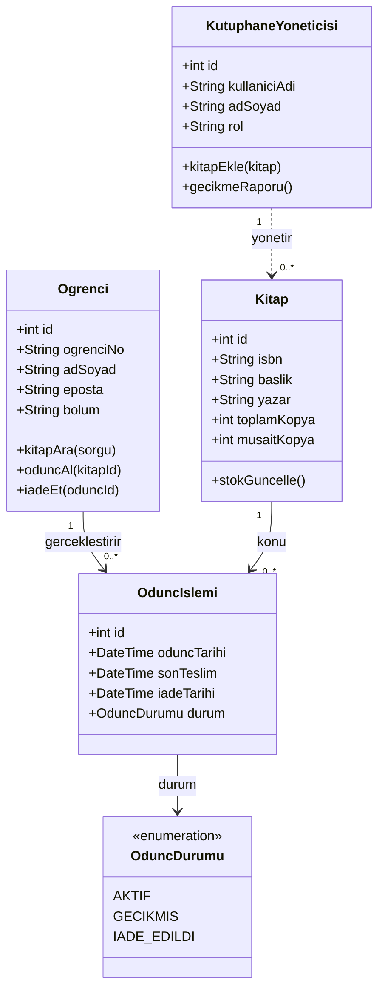
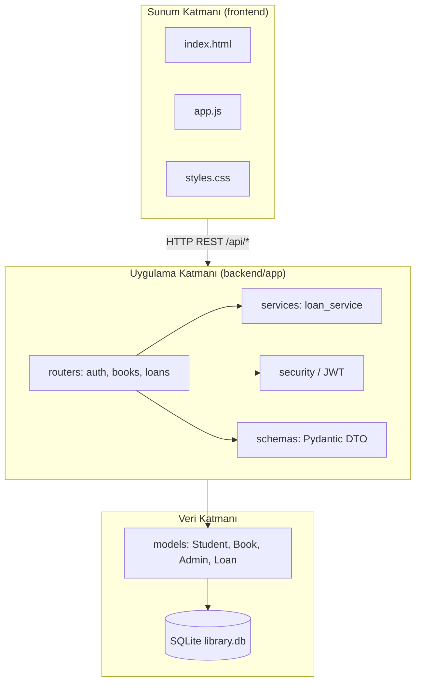
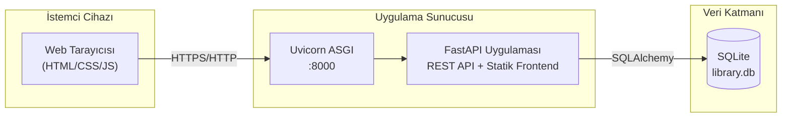

# Online Kütüphane Yönetim Sistemi — UML Diyagramları

Bu belge, proje teslimi için istenen sınıf, nesne, paket ve dağıtım diyagramlarını içerir. Diyagramlar [Mermaid](https://mermaid.js.org/) sözdizimi ile verilmiştir; GitHub, VS Code veya mermaid.live üzerinde görüntülenebilir.

---

## 1. Class Diagram (Sınıf Diyagramı)

En az dört sınıf: **Ogrenci**, **Kitap**, **KutuphaneYoneticisi**, **OduncIslemi**. İlişkiler ve çokluklar (multiplicity) gösterilmiştir.



**İlişki özeti**

| İlişki | Çokluk | Açıklama |
|--------|--------|----------|
| Ogrenci — OduncIslemi | 1 — 0..* | Bir öğrenci birden fazla ödünç işlemi yapabilir |
| Kitap — OduncIslemi | 1 — 0..* | Bir kitap için birden fazla ödünç kaydı olabilir (zaman içinde) |
| KutuphaneYoneticisi — Kitap | 1 — 0..* | Yönetici kitap envanterini yönetir (ekleme/güncelleme) |

Kod eşlemesi: `Student`, `Book`, `Admin`, `Loan`, `LoanStatus` (`backend/app/models/`).

---

## 2. Object Diagram (Nesne Diyagramı)

Örnek: **Ayşe Yılmaz** öğrencisinin **Effective Java** kitabını ödünç aldığı an.

```mermaid
classDiagram
    direction LR

    object ogrenci_ayse {
        id = 1
        ogrenciNo = "2024001"
        adSoyad = "Ayşe Yılmaz"
        eposta = "ogrenci@universite.edu.tr"
    }

    object kitap_effective_java {
        id = 1
        isbn = "9780134685991"
        baslik = "Effective Java"
        yazar = "Joshua Bloch"
        musaitKopya = 2
    }

    object odunc_1042 {
        id = 1042
        oduncTarihi = "2026-09-27"
        sonTeslim = "2026-10-11"
        durum = GECIKMIS
    }

    ogrenci_ayse --> odunc_1042 : oduncVeren
    kitap_effective_java --> odunc_1042 : oduncVerilen
```

Bu senaryo `backend/seed.py` ile veritabanına yüklenen demo gecikmiş ödünç kaydına karşılık gelir.

---

## 3. Package Diagram (Paket Diyagramı)

En az üç mantıksal paket: sunum (frontend), uygulama/API, veri erişimi.



---

## 4. Deployment Diagram (Dağıtım Diyagramı)

Web istemcisi, API sunucusu ve veritabanı katmanları.



**Üretim notu:** PostgreSQL kullanımı için `DATABASE_URL=postgresql://...` ortam değişkeni tanımlanır; kod aynı SQLAlchemy katmanını kullanır.

---

## 5. Dosya Yapısı (Kaynak Kod Özeti)

```
library-management-system/
├── backend/
│   ├── app/
│   │   ├── main.py              # FastAPI giriş, CORS, statik frontend
│   │   ├── config.py
│   │   ├── database.py
│   │   ├── security.py
│   │   ├── models/              # Ogrenci, Kitap, Yönetici, OduncIslemi
│   │   ├── schemas/
│   │   ├── routers/             # API uç noktaları
│   │   └── services/
│   ├── requirements.txt
│   └── seed.py
├── frontend/
│   ├── index.html
│   ├── css/styles.css
│   └── js/app.js
├── docs/
│   └── UML_DIYAGRAMLARI.md
└── README.md
```
